# Sentinel Edge — Secure AIOps Observability Platform

> **CICADA 2026 Hackathon** | Two-tier, local-first, privacy-preserving AIOps observability platform.  
> **Core Principle:** _Raw stays local. Metadata goes global._

---

## 1. System Architecture & Trust Boundary

The platform is strictly divided into two security tiers separated by an explicit **Customer Trust Boundary**. Raw logs, unredacted text, private IPs, credentials, and payload bodies never cross this boundary.

```mermaid
flowchart TB
    subgraph EdgeCustomerTier["EDGE TIER (Customer Trust Boundary — Local Machine)"]
        direction TB
        AppSources["Application & OS Sources\n(syslog, auth, psutil, containers)"]
        
        subgraph CollectorNode["Sentinel Edge Local Collector Node (Daemon)"]
            direction TB
            InputAdapters["Hop 1: Input Adapters\n(sim_stream :9000, syslog UDP/socket, psutil)"]
            RawDB[("Local SQLite WAL\n(collector_local.db)\n• raw_events (secrets visible)\n• egress_log (audit)\n• outbox (queue)")]
            
            RedactionEngine["Hop 2 & 3: Normalization & Egress Gate\n• contracts/allow-list.yaml\n• Pseudonymization (h_xxxxxxxx)\n• Regex Secret Scanner\n• Drop all unknown keys"]
            
            OutboxMgr["Hop 4: Outbox Store-and-Forward\n• Status: pending -> sent\n• FIFO Queue with exponential backoff\n• Offline Buffering (0 data loss)"]
        end
        
        AppSources -->|"Local IPC / Loopback"| InputAdapters
        InputAdapters -->|"Store un-redacted"| RawDB
        RawDB -->|"Inspect & Sanitize"| RedactionEngine
        RedactionEngine -->|"Allow-listed JSON metadata"| OutboxMgr
    end

    OutboxMgr ==>|"Hop 5: WAN HTTPS Ingestion (Port 8000 / 8002)\nHeaders: X-API-Key, X-Signature (HMAC-SHA256)\nPayload: ONLY UUIDv7 allow-listed metadata (no raw text)"| RegionalSaaS

    subgraph CentralSaaSTier["CENTRAL SAAS TIER (Regional Multi-Tenant Cloud)"]
        direction TB
        
        subgraph RegionalSaaS["Regional SaaS Gateway & Ingest Gate"]
            AuthCheck["Hop 6: Collector Auth & Regional Pin\n• HMAC verification\n• Region pinning check (EU vs IN)\n• Cross-region rejected with HTTP 421"]
            ServerValidator["Hop 7: Server Validation Gate\n• Strict contracts/allow-list.yaml\n• Unknown field rejection (400)\n• Pop & ignore client tenant_id"]
        end
        
        subgraph DataAndAIOps["SaaS Storage & AIOps Intelligence"]
            SaaSDatabase[("Regional SQLite WAL\n(saas_eu.db / saas_in.db)\n• Strict tenant_id isolation\n• ON CONFLICT DO NOTHING")]
            AIOpsEngine["Hop 8: AIOps Analytic Pipeline\n1. Dynamic Baseline Engine (Diurnal wave)\n2. Anomaly Detection (z-score > 3.0)\n3. Alert Correlation (Topology window)\n4. Governed Remediation (Policy & Rollback)"]
            SSEBroadcaster["SSE Event Stream Hub\n(/api/health/stream)"]
        end
        
        AuthCheck --> ServerValidator
        ServerValidator --> SaaSDatabase
        SaaSDatabase --> AIOpsEngine
        AIOpsEngine --> SSEBroadcaster
    end

    subgraph OperatorClient["OPERATOR CLIENT TIER"]
        direction TB
        WebDashboard["Hop 9: Thin Web Dashboard & CLI\n• Browser: http://localhost:8000/dashboard/\n• CLI: aiopsctl (health, incidents, why, inject)\n• Auth: SessionStorage Bearer Tokens"]
    end

    SSEBroadcaster -.->|"Real-time SSE push (1s)"| WebDashboard
    WebDashboard -->|"REST API Query (token auth)"| RegionalSaaS
```



### Network Hops & Boundaries Summary
| Hop | Source $\to$ Destination | Transport & Port | Security Controls & Payload Data |
| :--- | :--- | :--- | :--- |
| **Hop 1** | Local Sources $\to$ Collector | IPC / Localhost Socket (:9000) | Raw unredacted logs & telemetry metrics captured on the host. |
| **Hop 2 & 3** | Local DB $\to$ Redaction Gate | Internal Memory | Pre-egress allow-list enforcement (`contracts/allow-list.yaml`). Drops unknown keys, redacts secrets, hashes entity IDs (`h_xxxxxxxx`). |
| **Hop 4** | Gate $\to$ Outbox Queue | SQLite WAL (`collector_local.db`) | Store-and-forward outbox (`pending` status). Retains data safely across SaaS outages. |
| **Hop 5** | **Edge $\to$ Central SaaS (Trust Boundary)** | **HTTPS WAN (Port 8000 / 8002)** | **HMAC-SHA256 signature (`X-Signature`), API Key (`X-API-Key`). Payload is ONLY allow-listed JSON metadata. Raw text and secrets are physically excluded.** |
| **Hop 6 & 7** | Gateway $\to$ Ingest Gate | Internal Process | Region validation (EU vs IN). Mismatches return `421 Misdirected`. Server-side allow-list validation rejects unknown fields with `400`. |
| **Hop 8** | Storage $\to$ AIOps Pipeline | SaaS Internal Bus | Baseline evaluation, anomaly detection, topological incident correlation, and governed remediation with rollback plans. |
| **Hop 9** | Central SaaS $\to$ Dashboard/CLI | HTTP/SSE (Port 8000 / 8002) | Read-only bearer token authentication (`sessionStorage`), tenant-scoped queries, real-time Server-Sent Events. |

---

## 2. Quick Start: Running the Platform

### Option A: Automated Launch (Windows PowerShell)
We provide an automated startup script that launches all 4 services in their own titled windows and opens the central dashboard:

```powershell
cd c:\Users\arjun\Desktop\sentinel-edge-code\aiops-platform
.\start_demo.ps1
```

This starts:
1. **Window 1 (Simulator)**: Telemetry stream generator (`http://localhost:9000`)
2. **Window 2 (SaaS EU)**: Central SaaS EU Instance (`http://localhost:8000`, tenant `acme`)
3. **Window 3 (SaaS IN)**: Central SaaS IN Instance (`http://localhost:8002`, tenant `globex`)
4. **Window 4 (Collector)**: Live edge collector daemon (`col-acme-eu-1`)
5. **Browser**: Automatically opens `http://localhost:8000/dashboard/`

*(Keep all 4 service windows open during the evaluation.)*

---

### Option B: Manual Step-by-Step Launch

If running manually across separate terminal windows:

#### Prerequisites (Once)
```powershell
cd c:\Users\arjun\Desktop\sentinel-edge-code\aiops-platform
python -m venv .venv
.\.venv\Scripts\Activate.ps1
pip install -e ".[dev]"
python tools/gen_tokens.py
```

#### Window 1: Telemetry Simulator Server (Port 9000)
```powershell
cd c:\Users\arjun\Desktop\sentinel-edge-code\aiops-platform
.\.venv\Scripts\Activate.ps1
python -m uvicorn tools.sim_stream_server:app --host 0.0.0.0 --port 9000 --reload
```

#### Window 2: Central SaaS — EU Regional Instance (Port 8000, Tenant Acme)
```powershell
cd c:\Users\arjun\Desktop\sentinel-edge-code\aiops-platform
.\.venv\Scripts\Activate.ps1
$env:REGION = "eu"
$env:SAAS_DB_PATH = "saas_eu.db"
python -m uvicorn saas.main:app --host 0.0.0.0 --port 8000 --no-access-log --reload
```

#### Window 3: Central SaaS — IN Regional Instance (Port 8002, Tenant Globex)
```powershell
cd c:\Users\arjun\Desktop\sentinel-edge-code\aiops-platform
.\.venv\Scripts\Activate.ps1
$env:REGION = "in"
$env:SAAS_DB_PATH = "saas_in.db"
python -m uvicorn saas.main:app --host 0.0.0.0 --port 8002 --no-access-log --reload
```

#### Window 4: Edge Collector Daemon (col-acme-eu-1)
```powershell
cd c:\Users\arjun\Desktop\sentinel-edge-code\aiops-platform
.\.venv\Scripts\Activate.ps1
$env:COLLECTOR_ID = "col-acme-eu-1"
$env:COLLECTOR_DB_PATH = "collector_local.db"
python tools/live_feed_daemon.py
```

#### Browser: Open Dashboard
Open [http://localhost:8000/dashboard/](http://localhost:8000/dashboard/) and log in with your tenant viewer token from `.env` (`VIEWER_TOKEN_ACME`).

---

### Option C: Docker Alternative
To run the full stack as containerized microservices:
```powershell
docker compose up --build -d
```
Check health:
```powershell
docker compose ps
docker compose logs -f
```

---

## 3. Testing & Verification

### Run Phase 11 Acceptance Proof (`make proof`)
Executes the comprehensive benchmark suite across streaming latency, alert speed, offline detection, outage replay, deduplication, leak scanning, and tenant isolation:
```powershell
# Using Python proof runner:
python tools/run_proof.py

# Or using Makefile (via Git Bash / WSL / make):
make proof
```
*Outputs real numbers and certifies acceptance in `proof_report.md`.*

### Run Complete Unit & Integration Suite
Executes all 182 tests across the codebase:
```powershell
pytest -v
```

---

## 4. Live Chaos Injection CLI (`aiopsctl inject`)

Trigger failures on-demand matching the 8 judging scenarios:
```powershell
# Interactive numbered menu:
aiopsctl inject

# Direct one-click injections:
aiopsctl inject 1    # Raw log contains a secret
aiopsctl inject 2    # Collector loses SaaS connectivity (and restores)
aiopsctl inject 3    # Repeated failed logins
aiopsctl inject 4    # Network latency rises
aiopsctl inject 5    # CPU or memory deviates from baseline
aiopsctl inject 6    # Several alerts relate to one incident
aiopsctl inject 7    # Duplicate or out-of-order delivery
aiopsctl inject 8    # Remediation is proposed

# Run full rehearsal mode (all 8 in sequence):
aiopsctl rehearsal

# Reset platform to normal baseline:
aiopsctl reset
```
*(You can also trigger these scenarios directly from the Web Dashboard on **Tab 9: Chaos Injector**).*

---

## 5. Repository Structure

```
aiops-platform/
├── contracts/                  # Formal API, DB, and policy contracts
│   ├── allow-list.yaml         # Egress allow-list & secret scanner patterns
│   ├── remediation_policy.yaml # Governed remediation rules
│   ├── topology.yaml           # Entity dependency graph
│   ├── db_saas.sql             # Central multi-tenant schema
│   └── db_collector.sql        # Edge collector schema
├── collector/                  # Tier 1: Local edge collector
│   ├── cli.py                  # 'collector' CLI (raw, egress, status, buffer)
│   ├── normalize.py            # Local raw ingestion & normalization
│   ├── policy.py               # Pre-egress allow-list enforcement
│   ├── outbox.py               # Persistent SQLite store-and-forward FIFO
│   └── sender.py               # HMAC-signed WAN transmitter
├── saas/                       # Tier 2: Central SaaS
│   ├── api.py                  # REST API & SSE streaming endpoints
│   ├── cli_aiopsctl.py         # 'aiopsctl' CLI (health, incidents, why, inject)
│   ├── ingest.py               # Ingest gateway with idempotency
│   ├── validate.py             # Server-side allow-list validation gate
│   ├── tenancy.py              # Multi-tenant partitioning & query scoping
│   ├── regions.py              # Regional data residency gate (421 Misdirected)
│   ├── remediation.py          # Governed remediation state machine
│   └── aiops/                  # Correlation, baselines, and recommendations
├── dashboard/                  # Single-page web UI (Vanilla JS + Chart.js)
│   └── index.html              # 9-tab operations dashboard & chaos injector
├── tools/                      # Orchestration & testing utilities
│   ├── sim_stream_server.py    # Telemetry simulator (:9000)
│   ├── scenario_injector.py    # Chaos scenario injector engine
│   └── run_proof.py            # Phase 11 acceptance proof runner
├── tests/                      # 182 automated unit & integration tests
├── RUN_DEMO.md                 # Step-by-step evaluation runbook
├── SECURITY.md                 # Security architecture & privacy guarantees
├── LIMITATIONS.md              # Production readiness gaps & roadmap
└── DEMO.md                     # 6-minute spoken demo script
```
